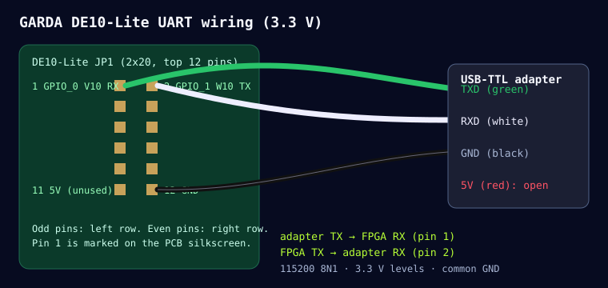

# Wiring: DE10-Lite ⇄ laptop (port A) and Jetson Nano (port B)

Two independent UART hosts share the FPGA through a frame-level arbiter
(`rtl/de10_lite/garda_uart_port_arbiter.v`): the first host to start a frame owns the
link until its response is complete. A frame sent while the other host owns the link
is dropped, and that host simply times out and retries. Read-only commands and the E-stop
are retried automatically by `garda_link.py`.

### Port A: laptop (USB-TTL cable)

| DE10-Lite JP1 pin | FPGA pin | Signal | Connect to | Typical cable colour |
|---|---|---|---|---|
| **1** | PIN_V10 (GPIO_0) | port A RX (FPGA input) | adapter **TXD** | **green** |
| **2** | PIN_W10 (GPIO_1) | port A TX (FPGA output) | adapter **RXD** | **white** |
| **12** | — | GND | adapter **GND** | **black** |
| 11 | — | 5 V | **leave unconnected** | red |

### Port B: Jetson Nano (J41 40-pin header, `/dev/ttyTHS1`, 3.3 V)

| DE10-Lite JP1 pin | FPGA pin | Signal | Jetson Nano J41 pin |
|---|---|---|---|
| **3** | PIN_V9 (GPIO_2) | port B RX (FPGA input) | **8** (UART2 TXD) |
| **4** | PIN_W9 (GPIO_3) | port B TX (FPGA output) | **10** (UART2 RXD) |
| **30** | — | GND | **6** (GND) |

On the Jetson: `sudo usermod -aG dialout $USER` (once), `pip3 install pyserial`, then
`python3 host/garda_cli.py --port /dev/ttyTHS1 ident`. `ident` also prints which port the
FPGA saw the request on (`PORT_INFO`, should say "B (Jetson)").

Pin numbers come from the DE10-Lite User Manual, Table 3-7 and Figure 3-18
(odd pins on one row, even pins on the other; pin 11 = 5 V, pin 12 = GND,
pin 29 = 3.3 V, pin 30 = GND). `scripts/check_pins.py` checks every QSF pin
against the extracted manual table (`docs/de10_lite_manual_pin_table.txt`).

**Rule:** TX goes to RX. Each transmitter drives the other side's receive pin.

## Electrical

* **3.3 V logic only.** MAX 10 GPIO banks on JP1 are 3.3-V LVTTL. A 5 V TTL adapter
  can damage the FPGA. Most PL2303HX/CP2102/FT232 cables use 3.3 V signal levels
  even though their red wire carries 5 V USB power. Measure if unsure.
* **Common ground is mandatory** (JP1 pin 12 or 30).
* Do not power the board from the adapter's red wire. The DE10-Lite is powered by its own USB-B cable.
* Both RX pins have the MAX 10 weak pull-up enabled, so an unconnected port idles high and
  cannot latch a protocol fault or be granted the link.

## Link parameters

| Item | Value |
|---|---|
| Baud rate | 115200 (divisor 391 at the 45 MHz core clock → 115090 baud, −0.09 %) |
| Format | 8 data bits, no parity, 1 stop bit, LSB first |
| Frame | 8 bytes, see [PROTOCOL.md](PROTOCOL.md) |
| Flow control | none; strictly one request → one response |
| Inter-byte timeout | 4 500 000 cycles at 45 MHz = 100 ms (a partial frame then latches `protocol_fault`) |
| Host response timeout | 250 ms per frame (garda_link.py) |

921600 baud: the RTL is parameterised (`python scripts/build.py --baud 921600` →
divisor 49 at 45 MHz, actual 918 367 baud, −0.35 %). This setting has been checked only at
the divisor level in the build script. It has **not** been run on the board. The
default build uses 115200, the rate the existing GARDA host tools and earlier
DE10-Nano measurements used.

## Other board connections

| Item | Use |
|---|---|
| USB-B (USB-Blaster) | power + JTAG programming (Quartus Programmer) |
| VGA connector | live 640×480 status screen drawn by the FPGA |
| KEY0 | reset (also clears host E-stop / watchdog latches) |
| KEY1 | physical E-stop (press = stop; latches until reset) |
| SW2 | UP = "not ready" (motor permission removed, fault 4) |
| SW3 | UP = protective stop (fault 3) |
| SW0, SW1, SW4–SW9 | unused; keep DOWN |

Keep **SW2 and SW3 DOWN** for normal operation.

## Windows and clone PL2303 adapters

Windows shows a counterfeit PL2303 chip as *"THIS IS NOT PROLIFIC PL2303"* and the
current Prolific driver refuses to create a COM port for it. Linux accepts these chips. So
`START_CONTROL_CENTER_WSL.bat` passes **only the UART adapter** to WSL with
usbipd-win (`usbipd bind --hardware-id 067b:2303` once, as Administrator) and
runs the Control Center there as `/dev/ttyUSB0`. The USB-Blaster stays on Windows,
where the Quartus Programmer uses it. Genuine FTDI/CP210x/CH340 adapters work
directly with `START_CONTROL_CENTER.bat`.
